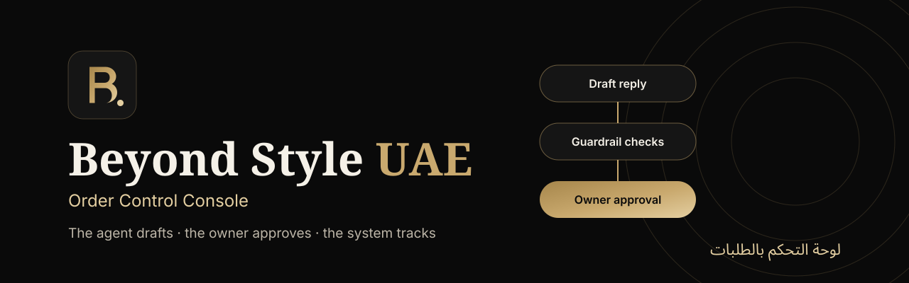
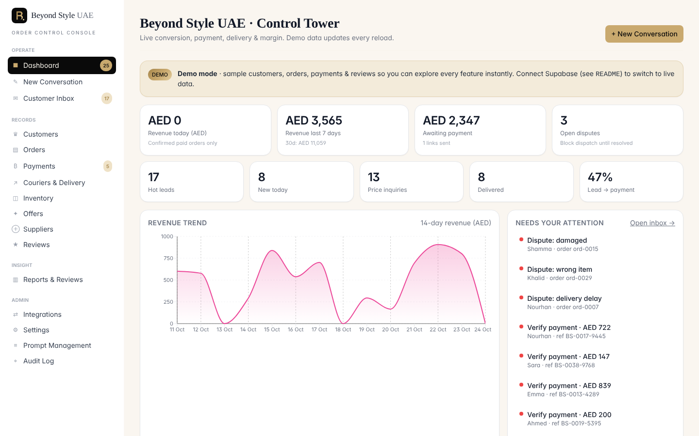
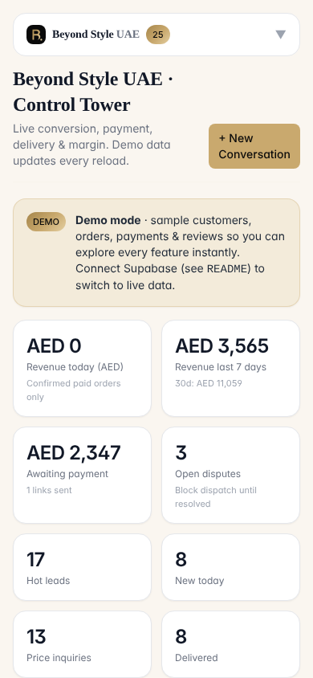
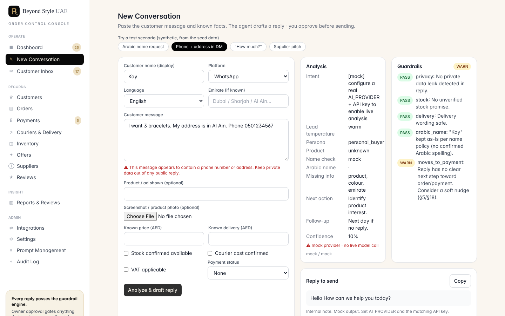
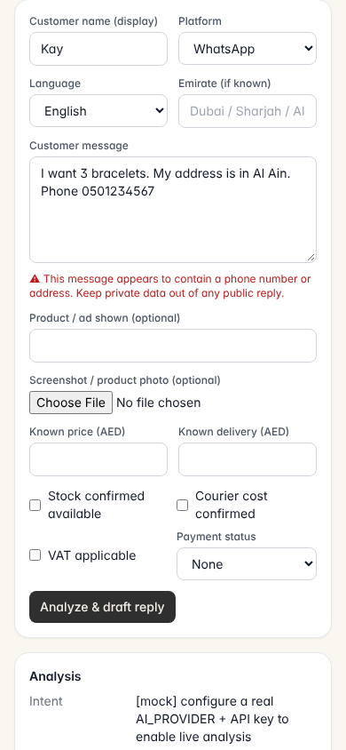
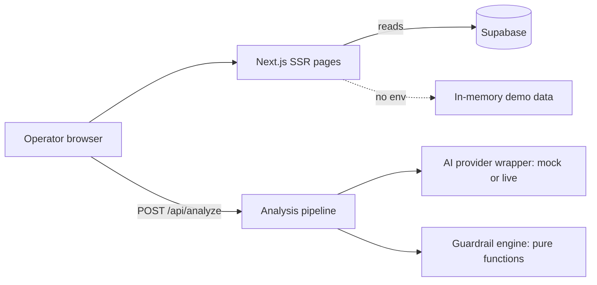

<p align="center">
  
</p>

<p align="center">
  <strong>A human-approved sales console for UAE social commerce. The agent drafts, the owner approves, the system tracks.</strong>
</p>

<p align="center">
  
  
  
  
  
  
</p>

## Overview

Beyond Style UAE (BEYOND CONNECT GENERAL TRADING L.L.C) sells fashion
jewellery and accessories through Instagram, WhatsApp and TikTok. This
repository is the internal **order control console**. It is not an
auto-reply bot. The agent drafts replies and order actions, the owner
approves them, and the dashboard tracks conversion, payment and delivery.
Automation comes later, only after the system proves it does not make
pricing, delivery, stock or privacy mistakes.

> The agent drafts → you approve → the system tracks → the dashboard learns → automation comes later.

Every drafted customer reply goes through a **guardrail engine** before an
operator can approve and send it. If you automate too early, you scale
mistakes. This MVP scales discipline instead.

## Key features

- **Intake to approval flow.** Paste a customer message and known facts (plus an optional screenshot). `POST /api/analyze` returns a structured analysis, guardrail findings and a draft reply to review and copy.
- **One-click test scenarios.** The intake page can load the §30 test conversations from `supabase/seed.sql` (Arabic name request, phone and address in a DM, "How much?", supplier pitch) so you can try the flow without typing.
- **Guardrail engine.** Pure, unit-tested checks for product claims, privacy, price, stock, delivery, payment, VAT and Arabic names (table below).
- **Operations rules.** QC checklist, human-approval matrix, fraud screening and journey-stage playbook in `src/lib/operations.ts`.
- **Control tower dashboard.** Revenue, payment, delivery and lead KPIs, a 14-day revenue chart and a "needs your attention" list.
- **Record pages.** Customers, orders, inventory, offers, payments, couriers, suppliers, reviews, reports, prompts, settings and audit log.
- **Demo mode.** With no Supabase project, every page renders from an in-memory sample dataset and shows a clear "Demo mode" banner.
- **Pluggable AI provider.** `mock`, OpenAI, Anthropic, Gemini, Groq, Together or any OpenAI-compatible endpoint, chosen by env. No keys in code.
- **NotebookLM integration.** Google OAuth 2.0 with AES-256-GCM encrypted tokens in an httpOnly cookie.
- **Mobile ready.** Collapsible navigation, and wide tables scroll inside their card so no page scrolls sideways at phone width.

## Screenshots

Captured from a local production build in demo mode (no Supabase, `AI_PROVIDER=mock`). All figures are synthetic sample data.

| Desktop (1440 x 900) | Mobile (390 x 844) |
|---|---|
|  |  |
|  |  |

## Quick start

Run these from the repository root (the Next.js console lives at the root).

```bash
npm ci
cp .env.example .env.local      # optional: Supabase + AI provider
npm run test                    # guardrail, OAuth and intake tests
npm run dev                     # http://localhost:3000
```

The app runs **before** Supabase is configured (demo data plus a banner)
and **before** an AI key is set (`AI_PROVIDER=mock` returns placeholder
analysis so you can see the flow end to end).

### Database

In the Supabase SQL editor (or via the CLI), run in order:

1. `supabase/migrations/0001_schema.sql`: all tables and RLS.
2. `supabase/migrations/0002_growth.sql`: disputes, VIP tracking and inventory velocity fields.
3. `supabase/seed.sql`: default catalogue, offers, couriers, prompts, settings and the §30 test-scenario conversations.

### Environment

`.env.example` documents every variable. None are required to build.

| Var | Purpose |
| --- | --- |
| `NEXT_PUBLIC_SUPABASE_URL` / `NEXT_PUBLIC_SUPABASE_ANON_KEY` | Supabase client (demo mode when unset) |
| `SUPABASE_SERVICE_ROLE_KEY` | Server-side privileged writes |
| `AI_PROVIDER` | `mock` (default), `openai`, `anthropic`, `gemini`, `groq`, `together`, `openai_compatible` |
| Provider keys and models | `OPENAI_*`, `ANTHROPIC_*`, `GEMINI_*`, `GROQ_*`, `TOGETHER_*`, `OPENAI_COMPATIBLE_*` |
| `GOOGLE_OAUTH_CLIENT_ID` / `GOOGLE_OAUTH_CLIENT_SECRET` | NotebookLM integration (page shows "not configured" when unset) |
| `GOOGLE_OAUTH_REDIRECT_URI`, `NOTEBOOKLM_OAUTH_SCOPES`, `INTEGRATION_TOKEN_SECRET` | Optional integration settings |
| `NEXT_PUBLIC_APP_URL` | Optional. Canonical URL for metadata |

## Scripts

| Script | What it does |
|---|---|
| `npm run dev` | Next.js dev server |
| `npm run build` | Production build |
| `npm run start` | Serve the production build |
| `npm run lint` | `next lint` |
| `npm run typecheck` | `tsc --noEmit` |
| `npm run test` | Vitest |

## The control tower (guardrail engine)

`src/lib/guardrails.ts` runs every drafted reply through checks. A **fail**
blocks the Approve button, a **warn** surfaces a caution, and some findings
force **owner approval**.

| Guard | Rule |
| --- | --- |
| Claim (§7) | Blocks "real gold", waterproof, anti-tarnish and similar claims without supplier evidence; rewords to safe wording |
| Privacy (§14) | Detects phone, address or payment data leaking into a reply |
| Price (§6) | Requires an active, unexpired offer before quoting; price first |
| Stock (§8) | Blocks unverified in-stock promises |
| Delivery (§10) | Blocks same-day outside Dubai without courier confirmation |
| Payment (§9) | No courier dispatch until payment is confirmed |
| VAT (§6/§9) | Flags a missing VAT line when applicable |
| Arabic name (§4) | Never blind-transliterates; falls back to أستاذة / أستاذ |
| Length / answered / payment step (§5/§29) | Keeps replies short, on point and converting |

## Project structure

```
src/
  app/                  App Router pages + API routes
    api/analyze/        POST analysis endpoint
    api/integrations/   NotebookLM OAuth routes
    intake/             intake → analysis → approval (flagship flow)
  components/           Nav, AnalysisPanel, RecordPage, charts, ui
  lib/
    guardrails.ts       control tower checks (pure, tested)
    arabic-names.ts     name accuracy (pure, tested)
    operations.ts       QC, approval matrix, playbook, fraud
    intake-samples.ts   §30 test scenarios for the intake form (tested)
    ai/                 provider wrapper, prompts, analysis pipeline
    data.ts             server reads with demo fallback
    demo/seed.ts        in-memory demo dataset
supabase/               migrations + seed
tests/                  Vitest suites
beyond-style-uae/       separate Vite + Hono customer storefront (own README)
```

## Architecture



More detail in [`DEVELOPER_NOTES.md`](./DEVELOPER_NOTES.md) and the threat
model in [`SECURITY.md`](./SECURITY.md).

## Deploy on Vercel

`vercel.json` at the root is already configured.

| Setting | Value |
|---|---|
| Framework preset | Next.js |
| Root directory | `./` (repository root) |
| Install command | `npm ci` |
| Build command | `npm run build` |
| Output directory | `.next` |
| Environment variables | Optional. See the table above. Without them the console runs in demo mode with the mock provider |

The storefront in `beyond-style-uae/` is a separate project. Deploy it as
its own Vercel project with root directory `beyond-style-uae` (see its README).

## Status and known limitations

Phase 1 of [`ROADMAP.md`](./ROADMAP.md) (control tower MVP).

- Routes are not yet gated by a session. `/login` works with Supabase, but there is no `middleware.ts`. Do not expose a deployment with live data publicly until it exists.
- Record pages are read-only lists. Create and edit forms are the next step.
- Screenshots are sent to the AI for analysis but not yet stored in Supabase Storage.
- Daily and weekly reviews show the section structure and KPIs. Auto-drafting is a follow-up.
- `.github/workflows/nextjs.yml` targets GitHub Pages static export. This app has API routes and server rendering, so that workflow is not a working deploy path. Vercel is.

## الملخص بالعربية

<div dir="rtl" lang="ar">

هذا المستودع هو **لوحة التحكم الداخلية بالطلبات** لمتجر Beyond Style UAE (شركة بيوند كونكت للتجارة العامة ذ.م.م).
اللوحة ليست نظام ردود آلية: يقوم الوكيل بصياغة مسودة الرد، ويعتمدها المالك، ثم يتتبّع النظام التحويل والدفع والتوصيل.
تمرّ كل مسودة رد عبر محرّك ضوابط يمنع الادعاءات غير الموثّقة عن المنتج، وتسريب البيانات الشخصية، وعروض الأسعار غير المعتمدة، ووعود المخزون أو التوصيل غير المؤكَّدة.
تعمل اللوحة دون إعداد Supabase باستخدام بيانات تجريبية واضحة التمييز، ودون مفتاح ذكاء اصطناعي باستخدام مزوّد تجريبي.
لا تزال المسارات غير محمية بجلسة تسجيل دخول، لذا لا يُنصح بنشر نسخة مرتبطة ببيانات حقيقية للعامة قبل إضافة هذه الحماية.

</div>

## Ownership

Owned by BEYOND CONNECT GENERAL TRADING L.L.C, Dubai. No open-source license file is included, so all rights are reserved by default.
